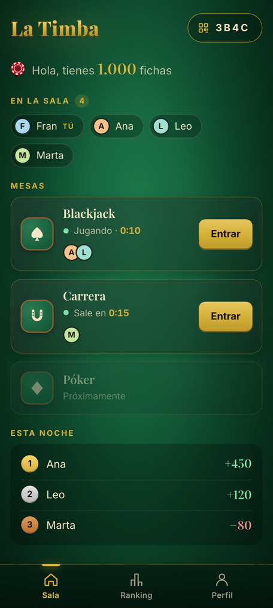
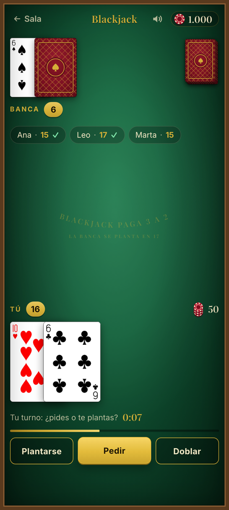
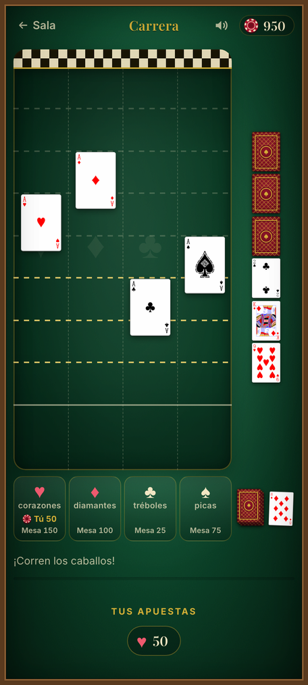
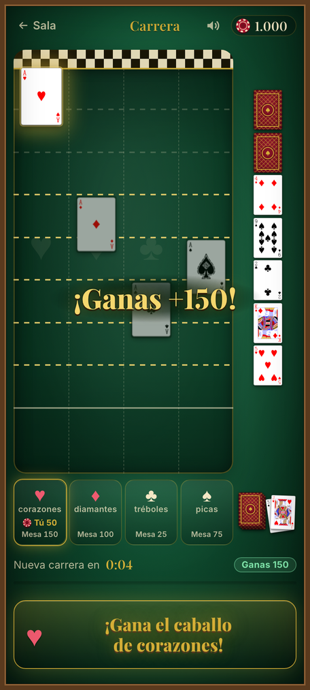
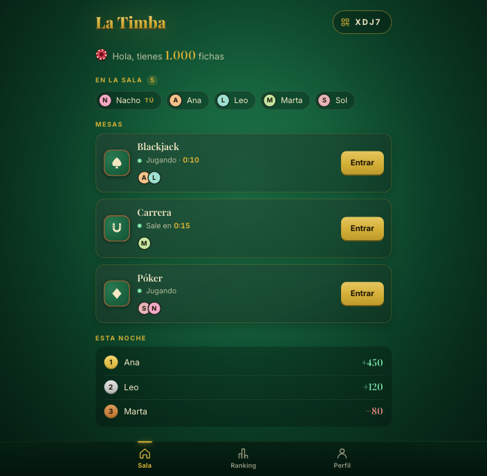
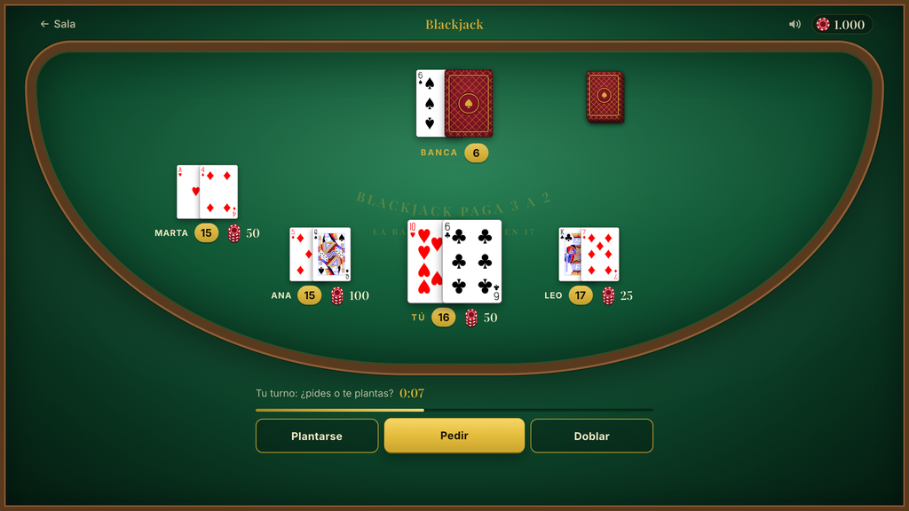
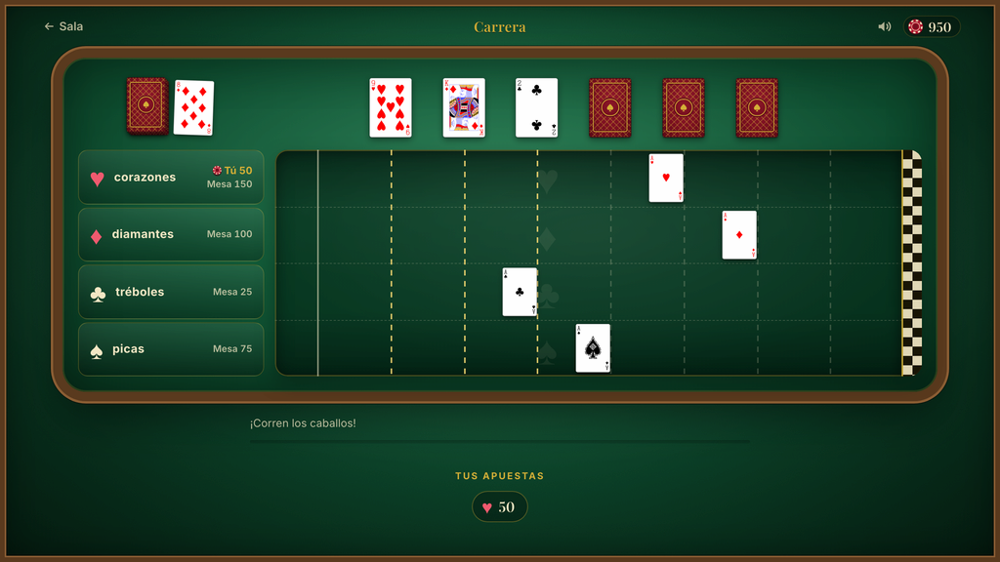
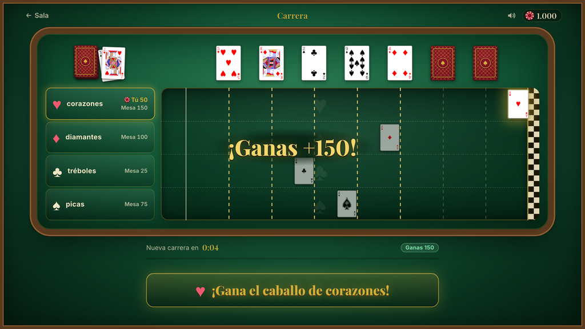
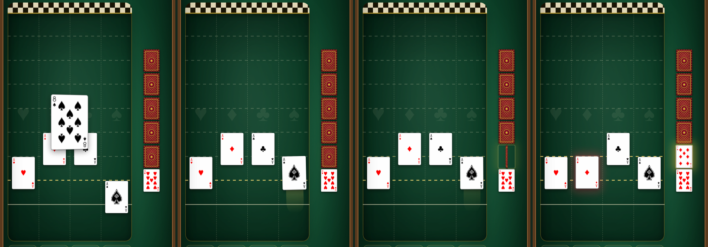
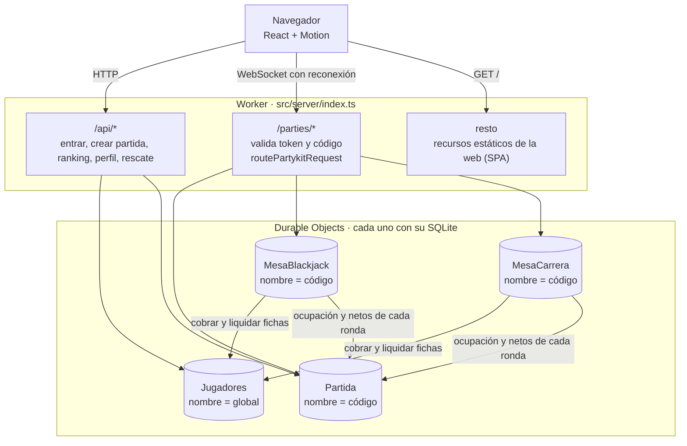

# La Timba

Una web para jugar a las cartas con amigos: **Blackjack** y una **carrera de caballos** con la baraja francesa, en un tapete de casino clásico. Alguien crea una partida, los demás entran con un código, un QR o un enlace, y cada uno juega con sus propias fichas (las mismas en todas las partidas) y un ranking compartido. Funciona en el móvil y en el ordenador, no necesita instalar nada y se aloja gratis en Cloudflare.

> **Demo: pendiente de desplegar**

<p align="center">
  
  
  
  
</p>

## Cómo se juega

1. **Entra** con un apodo y un PIN de 4 cifras. Si el apodo no existe, la web pregunta «¿Crear el perfil?» y, al aceptar, te da **1.000 fichas**.
2. **Crea una partida** (te da un código de 4 caracteres, un QR y un enlace) o **únete** con el de un amigo.
3. En la **sala** ves quién está conectado, qué hay en cada mesa y quién va ganando esta noche. Entra en la mesa que quieras y vuelve cuando quieras: la conexión con la sala se mantiene abierta mientras juegas (cada mesa abre además la suya). Ojo: salir de una mesa a propósito con una apuesta en juego la pierde.
4. **Blackjack.** Seis barajas, hasta 6 jugadores. Apuestas durante 15 s (desde 10 fichas y sin tope: con «Todo» te lo juegas todo), cada uno recibe dos cartas y decides en 15 s: *Pedir*, *Plantarse* o *Doblar*. La banca pide hasta 17 y se planta en cualquier 17 o más. Ganar paga 1:1, blackjack natural 3:2 y un empate devuelve la apuesta.
5. **Carrera de caballos.** Los cuatro ases son los caballos. Apuesta durante 20 s a uno o a varios (desde 10 fichas, sin tope por caballo, hasta 12 jugadores). Se levanta una carta cada 800 ms y avanza el caballo de su palo; cuando todos pasan un tramo de la pista se gira su carta y el caballo de ese palo retrocede. Gana el primero que llega a la meta y paga ×4 (apuesta incluida).
6. Si te quedas **sin fichas**, el perfil te ofrece un **rescate** de 200 (cuenta como una quiebra en tus estadísticas).

## Características

- **Dos juegos** con reglas completas, temporizadores y reconexión: si se corta la conexión o cierras la pestaña a mitad de ronda, al volver (dentro de esa misma ronda) sigues en tu mesa con tu mano. En blackjack, mientras estás desconectado tu mano se planta sola, y quien sigue desconectado cuando acaba la ronda deja la mesa.
- **Partidas con código, QR y enlace**; la sala se cierra sola tras 30 minutos sin nadie.
- **Fichas globales**: cada jugador tiene su propio saldo, el mismo en todas las partidas y mesas.
- **Ranking global** (fichas, ganancias, % de victorias, mayor premio, mejor racha y quiebras) y **ranking de cada noche**, además de un perfil con estadísticas por juego.
- **Animaciones cuidadas** con Motion: reparto desde el mazo, cartas que se giran en 3D, caballos con estela, fichas que vuelan de la bandeja a tu casilla del tapete (donde tu apuesta se apila y se ve en grande) y del premio al contador. Los movimientos solo usan `transform` y `opacity` (las transiciones de color de botones y pestañas son aparte) y, con `prefers-reduced-motion`, pasan a fundidos.
- **Sonido sintetizado** (cartas, fichas, victoria) con silencio recordado, y vibración corta al ganar donde el navegador la permita.
- **Hecha para el móvil**: botones de al menos 44 px, tu mano grande abajo, y en un móvil tumbado las mesas piden girarlo en vez de ofrecer un tapete que obligue a desplazarse. En el ordenador, la mesa completa con los asientos en semicírculo.
- **Coste 0 €**: solo el plan gratuito de Cloudflare, sin tarjeta.

<p align="center">
  
  
</p>

<p align="center">
  
  
</p>

Un paso de la carrera, fotograma a fotograma: sale un 8 de picas (el caballo avanza dejando estela), todos han pasado el tramo 2 y se gira su carta, un 7 de diamantes, así que el caballo de diamantes retrocede.

<p align="center">
  
</p>

## Arquitectura

Un único Worker de Cloudflare sirve la web, la API y los WebSockets; cada sala y cada mesa es un **Durable Object** con su propio SQLite. Una sola URL y un solo despliegue.



### Decisiones de diseño

- **El servidor manda, y cada jugador recibe su propia vista.** Las mesas guardan el estado verdadero y lo proyectan para cada conexión con `vista(estado, jugador)`: la baraja y la carta tapada de la banca no salen nunca del servidor. El cliente solo envía intenciones (`apostar`, `pedir`, `plantarse`…) y nunca decide un resultado. Además de la vista, cada mensaje trae los **eventos** ocurridos (`carta_repartida`, `caballo_avanza`, `pago`…) para que la pantalla los anime en orden y luego se asiente en la vista.
- **Reglas puras y compartidas.** Blackjack y carrera son funciones `(estado, acción) → estado` en `src/shared/juegos`, sin red, sin reloj y sin azar propio: el tiempo y el generador entran como parámetros (el barajado usa siempre `crypto.getRandomValues`). Se prueban con Vitest en milisegundos y una clase base, `Mesa`, las conecta con PartyServer. Añadir un juego es escribir un archivo de reglas, una clase pequeña y su pantalla.
- **Fichas en dos fases e idempotentes.** Antes de cobrar una apuesta la mesa guarda su intención; luego pide el cobro a `Jugadores` con una clave de idempotencia, y la intención se borra en la misma escritura que guarda la jugada. Un cobro que queda a medias (la instancia cayó, `Jugadores` no contestó) se anula con su clave, y cada ronda se liquida una sola vez por su identificador. Resultado: las fichas siempre cuadran, aunque las alarmas lleguen tarde o los mensajes se repitan.
- **Pensada para los límites del plan gratuito.** Durable Objects con SQLite, WebSockets con hibernación y temporizadores con **alarmas** del objeto (nada de `setInterval`), de modo que una mesa vacía no consume. Cada cambio de una mesa es una sola escritura, la alarma solo se reprograma si cambia su hora y la sala solo se entera de lo que enseña. La carrera se sortea entera al cerrarse las apuestas: sus pasos los anuncia un temporizador en memoria, sin escribir nada, y la única alarma es la de la meta. Las fichas se leen de una sola fila, y el perfil y los rankings leen una fila por jugador, no el historial. Una mesa sin apuestas deja de programar alarmas tras tres ventanas, la sala se cierra a los 30 minutos sin conexiones, cada conexión tiene un tope de 20 mensajes por segundo (más de 60 y se cierra con el código 4008), el registro admite 3 perfiles cada 10 minutos por IP (60 por hora en total) y cada jugador crea como mucho 5 partidas por hora. Si una mesa no puede guardar una jugada, se lo dice al jugador en vez de quedarse congelada, y si el fallo se repite pasa a «La Timba está descansando, vuelve mañana».
- **PBKDF2 con 10.000 iteraciones.** El PIN se guarda con PBKDF2-SHA256 y sal de 16 bytes. Con 100.000 iteraciones una sola invocación supera los 10 ms de CPU del plan gratuito (error 1102), así que se usan 10.000 y se compensa por otro lado: 5 fallos bloquean el apodo 15 minutos. La sesión es un token HMAC-SHA256 firmado con `TOKEN_SECRET` que caduca a los 30 días.
- **Fluidez medida.** Los movimientos solo usan `transform` y `opacity`. Se perfilaron carreras simuladas completas con la CPU a un cuarto de velocidad (CDP y `PerformanceObserver`, cada pasada con un servidor recién arrancado): en las últimas 11 no apareció ninguna tarea larga; antes solo hubo alguna suelta (la última, de 77 ms, justo al salir el cartel del ganador), lo que llevó a pedir su tipografía al abrir la mesa y no al ganar. A un sexto de velocidad sí se vieron cuadros de 51–64 ms al llegar el ganador. Los e2e comprueban además que con movimiento reducido las cartas aparecen ya en su sitio y que la mesa no se mueve bajo la mano.

## Tecnología

| Capa | Qué se usa |
|---|---|
| Cliente | React 18, Vite, [Motion](https://motion.dev), wouter, `qrcode.react`, TypeScript |
| Tiempo real | [PartyServer](https://github.com/cloudflare/partykit/tree/main/packages/partyserver) en el servidor y `partysocket` (con reconexión) en el cliente |
| Servidor | Cloudflare Workers y Durable Objects (SQLite), WebCrypto para el PIN y los tokens |
| Cartas y tipografías | `@letele/playing-cards`, Playfair Display e Inter (Fontsource) |
| Pruebas | Vitest con `@cloudflare/vitest-plugin` (Durable Objects reales en local) y Playwright |

## Ejecutarlo en local

> El estado del desarrollo en curso (qué está hecho, qué falta y cómo seguir) está en [`docs/ESTADO.md`](docs/ESTADO.md).

Hace falta Node.js 22 o superior (lo exige Wrangler).

```bash
npm i
cp .dev.vars.example .dev.vars     # y cambia TOKEN_SECRET
npm run dev                        # http://localhost:5173
```

`.dev.vars` guarda el secreto con el que se firman los tokens y Git lo ignora. Para generar uno fuerte: `openssl rand -base64 32`.

`npm run dev` arranca todo a la vez (la web, el Worker y los Durable Objects, con su estado en `.wrangler/`). Para ver la versión de producción en local: `npm run build` y `npx vite preview`.

## Pruebas

```bash
npm test          # unitarias y de integración (reglas puras, Durable Objects reales, utilidades del cliente)
npm run e2e       # Playwright con Chromium, en dos perfiles: escritorio y móvil (Pixel 7)
npx tsc --noEmit -p .
```

Los e2e juegan rondas de verdad contra el servidor local (varias pestañas a la vez) y también con la mesa simulada para provocar situaciones difíciles de conseguir a mano: reconexiones, errores del servidor, pagos que llegan tarde. Si es la primera vez, `npx playwright install chromium` descarga el navegador.

## Despliegue

Lo hace cada persona con su propia cuenta de Cloudflare (el plan gratuito basta):

```bash
npx wrangler login
openssl rand -base64 32 | npx wrangler secret put TOKEN_SECRET
npm run deploy
```

La segunda línea genera un secreto fuerte y lo guarda directamente, sin copiar ni pegar nada. Si `TOKEN_SECRET` falta o está vacío, la web responde «La Timba está descansando» y el registro de errores (`npx wrangler tail`) lo dice. La primera vez, la cuenta necesita un subdominio `workers.dev`: se crea solo al abrir **Workers & Pages** en el panel de Cloudflare.

`npm run deploy` construye el cliente y el Worker (`vite build`) y los sube con `wrangler deploy`. La configuración está en [`wrangler.jsonc`](wrangler.jsonc): los cuatro Durable Objects con su migración `new_sqlite_classes` y la web como recursos estáticos con *fallback* de aplicación de una sola página, de modo que `/p/KXP4` abre la partida también al recargar. La URL queda como `https://la-timba.<tu-cuenta>.workers.dev`.

Lo que gasta una noche típica (8 jugadores durante 3 horas: unas 330 rondas de blackjack y 240 carreras) se mide en [`test/server/presupuesto.test.ts`](test/server/presupuesto.test.ts), que juega rondas de verdad contra los Durable Objects y cuenta lo que factura Cloudflare. Extrapolado a la noche: unas 27.300 filas escritas (27 % del límite diario gratuito de 100.000), 14.600 peticiones a Durable Objects (15 %), 7.300 peticiones al Worker (7 %) y 23.000 filas leídas (0,5 % de 5 millones), por debajo del objetivo de no pasar del 30 % de ningún límite. Dicho en horas: lo que se agota antes son las filas escritas, y caben unas **11 horas de juego al día con 8 jugadores** (4 en cada mesa). La mayoría de esas escrituras son del libro de fichas (cinco por apuesta: la intención y la jugada en la mesa, el cobro, las fichas y su liquidación). Es una estimación: lo que cuenta es el panel de Cloudflare después de una noche real.

## Estructura

```
src/
  shared/    cartas, protocolo y reglas puras de los juegos (se usan en cliente y servidor)
  server/    Worker (API y WebSockets), Durable Objects (Jugadores, Partida, mesas) y autenticación
  client/    pantallas, componentes, red, efectos (movimiento, sonido) y el tema visual
test/        Vitest: reglas, servidor y utilidades del cliente
e2e/         Playwright: pantallas, mesas y movimiento
docs/        especificación y plan de implementación, y las capturas de este README
```

## Créditos

- **Cartas**: diseño de [Adrian Kennard](https://www.me.uk/cards/) (dominio público, CC0), a través del paquete [`@letele/playing-cards`](https://www.npmjs.com/package/@letele/playing-cards). El reverso es propio.
- **Tipografías**: [Playfair Display](https://fonts.google.com/specimen/Playfair+Display) e [Inter](https://rsms.me/inter/), con licencia SIL Open Font License, servidas con [Fontsource](https://fontsource.org).
- **Sonidos**: no hay archivos de audio; los sonidos de cartas, fichas y victoria se sintetizan con la Web Audio API en [`src/client/efectos/sonidos.ts`](src/client/efectos/sonidos.ts).
- Hecho con [PartyServer](https://github.com/cloudflare/partykit/tree/main/packages/partyserver), [Motion](https://motion.dev) y [Cloudflare Workers](https://workers.cloudflare.com).
